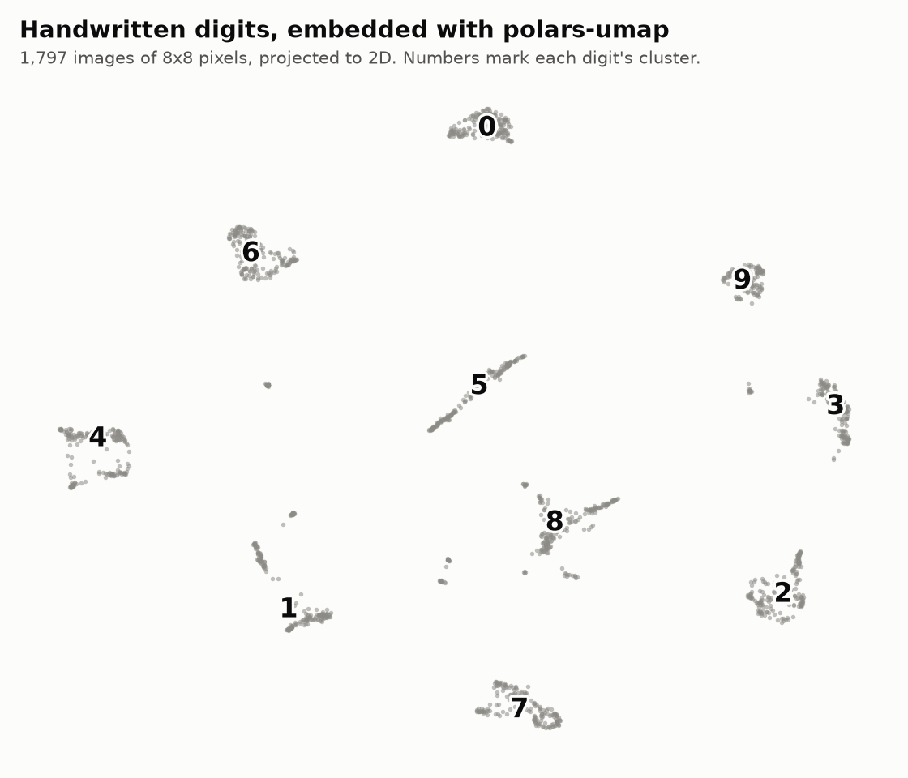
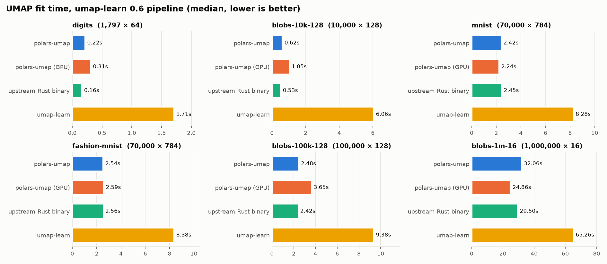

# polars-umap

**UMAP dimensionality reduction as a Polars plugin.**

```python
import polars as pl
import polars_umap  # registers the `umap` namespace

df.with_columns(xy=pl.col("embedding").umap.fit_transform(metric="cosine"))
```

polars-umap runs [UMAP](https://umap-learn.readthedocs.io) (Uniform Manifold Approximation and
Projection) directly inside Polars expressions. It is powered by the Rust ports of umap-learn and
PyNNDescent from Apple's [embedding-atlas](https://github.com/apple/embedding-atlas).

- **Native Polars**: works on `Array`/`List` embedding columns or plain numeric columns, in eager
  and lazy mode, in `select`/`with_columns`, and per group with `.over()` or `group_by().agg()`.
- **Fast**: multithreaded Rust and SIMD distances, with optional GPU acceleration (Metal, Vulkan, DX12).
  There is no numba JIT warm-up. See [benchmarks](docs/benchmarks.md).
- **Faithful**: reproduces the umap-learn 0.6 pipeline by default, or the classic 0.5 pipeline with
  `layout="0.5"`. Embedding quality matches umap-learn.
- **Reproducible**: with the default layout, `random_state` gives bit-identical results regardless of
  the number of threads.
- **Small footprint**: a single wheel that depends only on Polars. It supports Python ≥ 3.9 and
  Polars ≥ 1.0.

## Installation

```bash
uv add polars-umap
# or
pip install polars-umap
```

## Quick start

```python
import polars as pl
import polars_umap as pu
from sklearn.datasets import load_digits

X, y = load_digits(return_X_y=True)
df = pl.DataFrame({"pixels": X, "digit": y})  # pixels: Array(Float64, 64)

# Expression API: returns an Array(Float32, 2) column
df = df.with_columns(xy=pl.col("pixels").umap.fit_transform(random_state=42))

# DataFrame API: adds umap_0, umap_1 columns
df.umap.fit_transform("pixels", random_state=42)
```



## Usage

### Inputs

```python
# A single Array or List column with one vector per row
pl.col("embedding").umap.fit_transform()

# Several numeric columns, stacked into a feature matrix
pu.umap("sepal_length", "sepal_width", "petal_length", "petal_width")
pu.umap(cs.numeric())          # selectors work too
pu.umap(pl.col("^feat_.*$"))   # ...and regexes
```

Values of any numeric dtype are converted to `Float32`.

### Output

Expressions return an `Array(Float32, n_components)` column named after the first input. The
`df.umap` and `lf.umap` helpers can split it into one column per component:

```python
df.umap.fit_transform("embedding", n_components=3)                 # umap_0, umap_1, umap_2
df.umap.fit_transform("embedding", output="array", name="xyz")     # one Array column
df.umap.fit_transform("embedding", prefix="dim_")                  # dim_0, dim_1
```

To unpack an expression's result yourself, use `pl.col("xy").arr.get(0)` or
`pl.col("xy").arr.to_struct()`.

### One UMAP per group

UMAP is fitted on all rows the expression sees, so window and group contexts run an independent UMAP
per group, all within a single query:

```python
df.with_columns(xy=pl.col("embedding").umap.fit_transform(random_state=0).over("category"))

df.group_by("category").agg(pl.col("id"), pl.col("embedding").umap.fit_transform().alias("xy"))
```

### Lazy

```python
(
    pl.scan_parquet("embeddings.parquet")
    .filter(pl.col("lang") == "en")
    .umap.fit_transform("embedding", metric="cosine")
    .sink_parquet("projected.parquet")
)
```

### Missing values

By default, rows that are null or contain null, NaN or infinite values raise an error. With
`null_policy="ignore"`, UMAP is fitted on the remaining rows and the invalid rows get a null result.
The output always has as many rows as the input.

```python
pl.col("embedding").umap.fit_transform(null_policy="ignore")
```

### Nearest neighbors

The approximate nearest neighbor search that UMAP uses (a Rust port of PyNNDescent) is also
available on its own:

```python
df.with_columns(nn=pl.col("embedding").umap.knn(k=10, metric="cosine"))
# nn: Struct{indices: Array(UInt32, 10), distances: Array(Float32, 10)}
```

As in PyNNDescent, every row is its own first neighbor, at distance 0.

If you already have neighbors, for example from `knn()`, an exact search or a vector database, run
UMAP on the graph directly:

```python
nn = df.select(pl.col("embedding").umap.knn(k=15)).unnest("embedding")
nn.select(xy=pu.umap_from_knn("indices", "distances"))
```

### Parameters

The parameter names and defaults are the same as umap-learn's:

| Parameter | Default | |
|---|---|---|
| `n_components` | `2` | Dimensionality of the embedding |
| `n_neighbors` | `15` | Neighborhood size; larger values preserve more global structure |
| `min_dist` | `0.1` | Minimum distance between embedded points |
| `spread` | `1.0` | Scale of the embedded points |
| `metric` | `"euclidean"` | `euclidean`, `manhattan`, `chebyshev`, `minkowski`, `cosine`, `correlation`, `hamming` |
| `n_epochs` | `None` | Optimization epochs; chosen from the data size when `None` |
| `learning_rate` | `1.0` | |
| `init` | `"auto"` | `auto`, `recursive`, `spectral`, `tswspectral`, `pca`, `random`, or an array / Series / expression |
| `negative_sample_rate` | `5` | |
| `repulsion_strength` | `1.0` | |
| `local_connectivity` | `1.0` | |
| `set_op_mix_ratio` | `1.0` | |
| `a`, `b` | `None` | Derived from `min_dist` and `spread` when `None` |
| `random_state` | `None` | Seed |
| `optimizer` | `None` | `adam` (default for 0.6), `momentum`, `sgd` (default for 0.5) |
| `layout` | `"0.6"` | Which umap-learn pipeline to reproduce |
| `disconnection_distance` | `None` | |
| `null_policy` | `"error"` | `error` or `ignore` |
| `n_threads` | `None` | Size of a dedicated thread pool; see below |
| `gpu` | `False` | Use the GPU, falling back to the CPU when there is none |
| `verbose` | `False` | Print progress |

### Layouts and reproducibility

- `layout="0.6"` (the default) is the umap-learn 0.6 pipeline: recursive initialization and a
  deterministic Adam optimizer. The same `random_state` gives exactly the same embedding, whatever
  the number of threads.
- `layout="0.5"` is the classic umap-learn 0.5 pipeline: spectral initialization and Hogwild SGD.
  Hogwild SGD updates the embedding from many threads without locking, so multithreaded results
  vary slightly between runs even with a seed. Their quality does not. Use `n_threads=1` for exact
  reproducibility.

### Threads

By default UMAP runs on one shared thread pool. It is sized by `RAYON_NUM_THREADS`, then
`POLARS_MAX_THREADS`, then the number of CPUs. Groups that Polars evaluates concurrently share this
pool instead of oversubscribing the machine. Pass `n_threads=` to use a dedicated pool of that size.

### GPU

`gpu=True` runs the nearest neighbor search and layout optimization on the GPU via
[wgpu](https://wgpu.rs) (Metal on macOS, Vulkan or DirectX 12 elsewhere). When no suitable adapter
is found, it falls back to the CPU. Device setup has a fixed cost, so the GPU only pays off for large
datasets; see the [benchmarks](docs/benchmarks.md).

### What polars-umap doesn't do

The upstream implementation only fits, so there is no `transform()` for new, unseen points and no
`inverse_transform()`. Supervised UMAP (`y=`), densMAP and sparse inputs aren't supported either.

## Benchmarks



- **2–12× faster than umap-learn**, with the same trustworthiness, kNN recall and label accuracy.
  This excludes umap-learn's 10–12 s numba warm-up.
- **No measurable overhead from Polars**: polars-umap is as fast as the raw upstream Rust binary.
- **`.over()` with 1,000 groups**: 18 s, against 58 s for a Python loop.

See [docs/benchmarks.md](docs/benchmarks.md) for all results (both pipelines, CPU and GPU, memory,
quality) and the methodology.

## How it works

polars-umap is a [Polars expression plugin](https://docs.pola.rs/user-guide/plugins/). The
expressions are registered as non-elementwise, so Polars passes the whole column, or the whole group,
to the Rust function. There, the input is converted to a dense `f32` matrix in one pass. The upstream
`umap` crate builds the neighbor graph and optimizes the layout, and the result is written back as a
`FixedSizeList` (Polars `Array`) without per-row allocations.

## Development

```bash
uv sync                                                 # builds the extension (release mode)
uv run maturin develop --uv --profile dev-release      # faster rebuilds while developing
uv run pytest -n auto                                   # Python tests
uv run --group parity pytest -m parity                  # compare with umap-learn
cargo test --lib                                        # Rust tests
uv run ruff check . && uv run ruff format --check . && uv run mypy
cargo fmt --check && cargo clippy --all-targets -- -D warnings
uv run --group bench python benchmarks/run.py --quick   # benchmarks
```

## Acknowledgements

The algorithms are implemented by Apple's
[embedding-atlas](https://github.com/apple/embedding-atlas) (MIT), which ports
[umap-learn](https://github.com/lmcinnes/umap) and
[PyNNDescent](https://github.com/lmcinnes/pynndescent) by Leland McInnes. Please cite the UMAP paper
if you use this in research:

> McInnes, L., Healy, J., & Melville, J. (2018). UMAP: Uniform Manifold Approximation and Projection
> for Dimension Reduction. arXiv:1802.03426.

## License

MIT. See [LICENSE](LICENSE) and [NOTICE](NOTICE).
