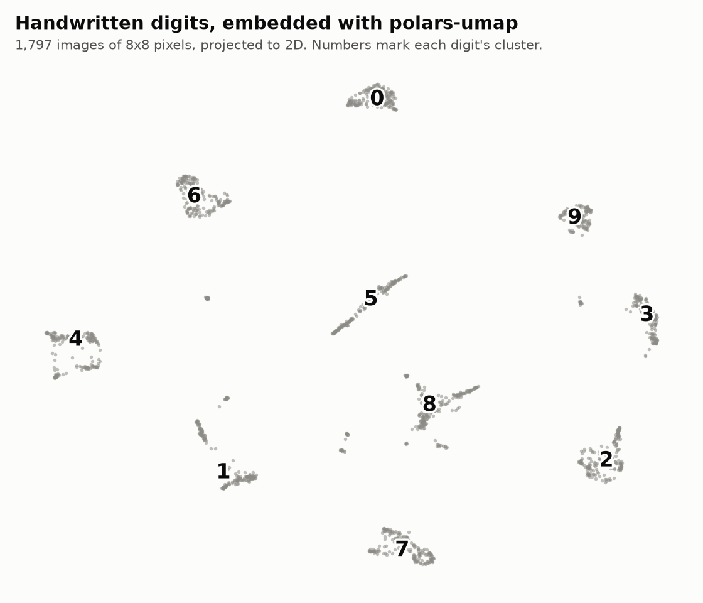
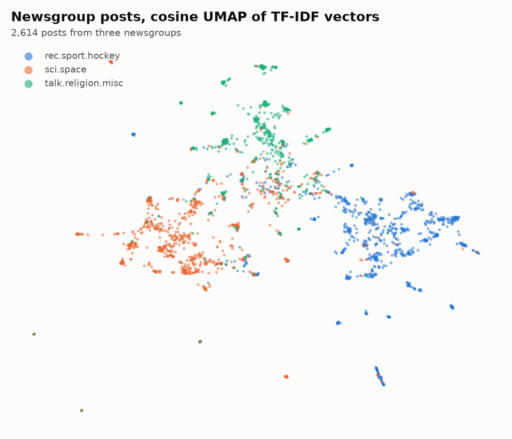

# Examples

All examples live in [`examples/`](https://github.com/jeroenjanssens/polars-umap/tree/main/examples)
and run with `uv run --group examples python examples/<name>.py`.

## Quick start



```python
--8<-- "quickstart.py"
```

## Text embeddings (cosine)



```python
--8<-- "text_embeddings.py"
```

## One UMAP per group

```python
--8<-- "per_group.py"
```

## Lazy Parquet pipeline

```python
--8<-- "lazy_parquet.py"
```

## Nearest neighbors and precomputed graphs

```python
--8<-- "precomputed_knn.py"
```

## Interactive notebook

`uv run --group examples marimo edit examples/notebook.py` opens a marimo notebook with sliders for
`n_neighbors`, `min_dist` and the layout.
