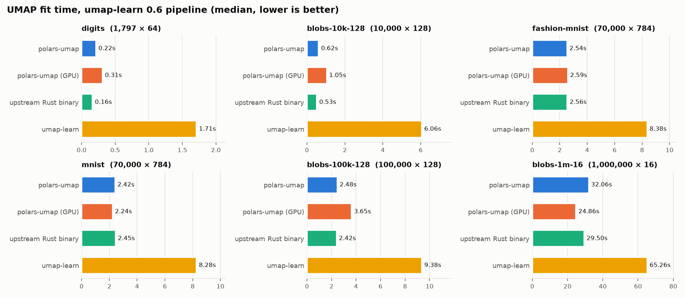
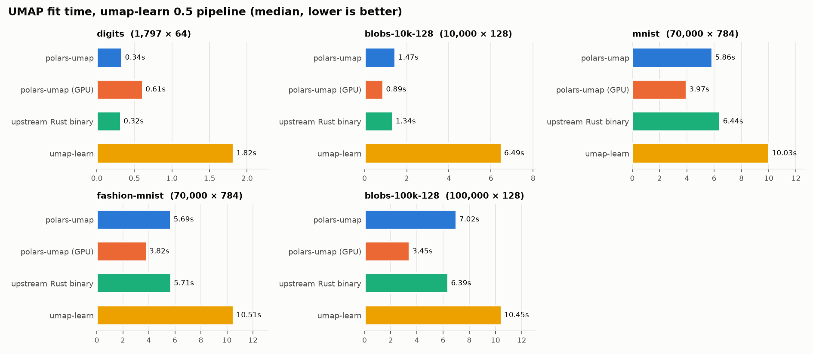

<!-- Generated by benchmarks/report.py from benchmarks/results/*.jsonl. Edit benchmarks/report_template.md, not this file. -->

Measured on an Apple Silicon laptop (details under [Machine](#machine)) on 2026-11-20.

**Key findings**

- **2–12× faster than umap-learn with the same quality.** With the 0.6 pipeline, polars-umap fits
  10,000 × 128 vectors in about 0.6 s, against 6.1 s for umap-learn. It fits MNIST (70,000 × 784)
  in 2.4 s, against 8.3 s. Trustworthiness, kNN recall and label accuracy agree with umap-learn to
  within about ±0.01 on every dataset. The speedup is largest on small and medium data, where
  umap-learn's Python overhead dominates.
- **The Polars layer costs (almost) nothing.** polars-umap is about as fast as upstream's native
  `umap-bench` binary, which runs the same Rust code on a raw `f32` file.
  - In the first pass, the two matched to within 0.01–0.03 s on every dataset.
  - The polars-umap rows for digits, blobs and 1M were rerun after a memory fix, hours later on a
    warmer machine. Those reruns came out 5–15% slower. Compare with care across rows that weren't
    measured back to back.
  - Peak memory is the upstream peak plus roughly 100 MB for the Python interpreter and Polars.
- **The 0.6 pipeline is the faster default.** It is 2–3× faster than the 0.5 pipeline, with the same
  quality, and it is deterministic.
- **The GPU helps in specific cases:**
  - the 0.5 pipeline from about 10,000 rows (1.5–2× faster than the CPU);
  - very large inputs (1M rows: 25 s vs 32 s).
  - For small data and the default 0.6 pipeline, device setup outweighs the gain, so `gpu=False`
    stays the default.
- **Per-group UMAP is where Polars shines.** One `.over("g")` query fits 1,000 separate UMAPs in
  18 s, against 58 s for a Python loop over polars-umap. umap-learn needs 23 s for just 100 groups.
- **No JIT warm-up.** umap-learn's numba compilation, excluded from the times above, adds 10–12 s
  to the first call in every new process. polars-umap is ready as soon as it's imported.





## Results

Fit time is the median over the repeats (min–max in parentheses). Quality is measured once per
configuration on a fixed random sample of 5,000 points:

- **Trustworthiness** (scikit-learn, k = 15): are the neighbors in the embedding real neighbors
  in the input?
- **kNN recall**: the fraction of each point's 15 nearest input-space neighbors that are also among
  its 15 nearest embedding neighbors. This is the metric the upstream benchmark uses.
- **Label kNN accuracy**: 3-fold cross-validated accuracy of a 5-NN classifier on the embedding,
  i.e. how well the known classes separate.

| Dataset | Rows × dims | Layout | Implementation | Fit time (s) | vs umap-learn | Peak RSS (MB) | Trustworthiness | kNN recall | Label kNN acc. |
|---|---|---|---|---:|---:|---:|---:|---:|---:|
| digits | 1,797 × 64 | 0.6 | polars-umap | 0.22 (0.21–0.22) | 7.9× | 108 | 0.984 | 0.489 | 0.987 |
| digits | 1,797 × 64 | 0.6 | polars-umap (GPU) | 0.31 (0.29–0.43) | 5.5× | 357 | 0.985 | 0.495 | 0.988 |
| digits | 1,797 × 64 | 0.6 | upstream Rust binary | 0.16 (0.16–0.17) | 10.4× | 30 | 0.984 | 0.489 | 0.987 |
| digits | 1,797 × 64 | 0.6 | umap-learn | 1.71 (1.71–1.82) | 1.0× | 680 | 0.985 | 0.497 | 0.988 |
| digits | 1,797 × 64 | 0.5 | polars-umap | 0.34 (0.33–0.38) | 5.4× | 106 | 0.986 | 0.532 | 0.988 |
| digits | 1,797 × 64 | 0.5 | polars-umap (GPU) | 0.61 (0.56–0.64) | 3.0× | 391 | 0.987 | 0.532 | 0.988 |
| digits | 1,797 × 64 | 0.5 | upstream Rust binary | 0.32 (0.30–0.35) | 5.7× | 28 | 0.987 | 0.535 | 0.988 |
| digits | 1,797 × 64 | 0.5 | umap-learn | 1.82 (1.81–1.83) | 1.0× | 673 | 0.988 | 0.534 | 0.988 |
| blobs-10k-128 | 10,000 × 128 | 0.6 | polars-umap | 0.62 (0.59–0.65) | 9.7× | 225 | 0.978 | 0.075 | 1.000 |
| blobs-10k-128 | 10,000 × 128 | 0.6 | polars-umap (GPU) | 1.05 (0.97–1.09) | 5.8× | 477 | 0.978 | 0.073 | 1.000 |
| blobs-10k-128 | 10,000 × 128 | 0.6 | upstream Rust binary | 0.53 (0.50–0.66) | 11.5× | 134 | 0.978 | 0.075 | 1.000 |
| blobs-10k-128 | 10,000 × 128 | 0.6 | umap-learn | 6.06 (6.03–6.15) | 1.0× | 762 | 0.978 | 0.073 | 1.000 |
| blobs-10k-128 | 10,000 × 128 | 0.5 | polars-umap | 1.47 (1.46–1.48) | 4.4× | 224 | 0.979 | 0.094 | 1.000 |
| blobs-10k-128 | 10,000 × 128 | 0.5 | polars-umap (GPU) | 0.89 (0.89–0.97) | 7.3× | 439 | 0.979 | 0.094 | 1.000 |
| blobs-10k-128 | 10,000 × 128 | 0.5 | upstream Rust binary | 1.34 (1.32–1.35) | 4.8× | 143 | 0.979 | 0.094 | 1.000 |
| blobs-10k-128 | 10,000 × 128 | 0.5 | umap-learn | 6.49 (6.48–6.56) | 1.0× | 737 | 0.979 | 0.091 | 1.000 |
| fashion-mnist | 70,000 × 784 | 0.6 | polars-umap | 2.54 (2.51–2.59) | 3.3× | 1,260 | 0.973 | 0.304 | 0.758 |
| fashion-mnist | 70,000 × 784 | 0.6 | polars-umap (GPU) | 2.59 (2.33–2.67) | 3.2× | 1,187 | 0.973 | 0.304 | 0.756 |
| fashion-mnist | 70,000 × 784 | 0.6 | upstream Rust binary | 2.56 (2.50–2.58) | 3.3× | 956 | 0.973 | 0.304 | 0.758 |
| fashion-mnist | 70,000 × 784 | 0.6 | umap-learn | 8.38 (8.37–8.44) | 1.0× | 1,528 | 0.973 | 0.302 | 0.763 |
| fashion-mnist | 70,000 × 784 | 0.5 | polars-umap | 5.69 (5.66–5.71) | 1.8× | 1,571 | 0.975 | 0.315 | 0.765 |
| fashion-mnist | 70,000 × 784 | 0.5 | polars-umap (GPU) | 3.82 (3.71–3.88) | 2.8× | 1,290 | 0.973 | 0.309 | 0.760 |
| fashion-mnist | 70,000 × 784 | 0.5 | upstream Rust binary | 5.71 (5.59–5.81) | 1.8× | 1,472 | 0.975 | 0.313 | 0.766 |
| fashion-mnist | 70,000 × 784 | 0.5 | umap-learn | 10.51 (10.50–10.74) | 1.0× | 1,366 | 0.975 | 0.312 | 0.757 |
| mnist | 70,000 × 784 | 0.6 | polars-umap | 2.42 (2.41–2.47) | 3.4× | 1,239 | 0.950 | 0.282 | 0.970 |
| mnist | 70,000 × 784 | 0.6 | polars-umap (GPU) | 2.24 (2.20–2.24) | 3.7× | 1,121 | 0.950 | 0.277 | 0.968 |
| mnist | 70,000 × 784 | 0.6 | upstream Rust binary | 2.45 (2.44–2.46) | 3.4× | 1,053 | 0.950 | 0.282 | 0.970 |
| mnist | 70,000 × 784 | 0.6 | umap-learn | 8.28 (8.28–8.35) | 1.0× | 1,511 | 0.951 | 0.283 | 0.968 |
| mnist | 70,000 × 784 | 0.5 | polars-umap | 5.86 (5.82–5.91) | 1.7× | 1,537 | 0.951 | 0.289 | 0.969 |
| mnist | 70,000 × 784 | 0.5 | polars-umap (GPU) | 3.97 (3.96–3.99) | 2.5× | 1,269 | 0.951 | 0.286 | 0.969 |
| mnist | 70,000 × 784 | 0.5 | upstream Rust binary | 6.44 (6.06–6.73) | 1.6× | 1,449 | 0.952 | 0.290 | 0.969 |
| mnist | 70,000 × 784 | 0.5 | umap-learn | 10.03 (9.79–10.13) | 1.0× | 1,378 | 0.951 | 0.286 | 0.969 |
| blobs-100k-128 | 100,000 × 128 | 0.6 | polars-umap | 2.48 (2.44–2.53) | 3.8× | 1,032 | 0.978 | 0.063 | 1.000 |
| blobs-100k-128 | 100,000 × 128 | 0.6 | polars-umap (GPU) | 3.65 (3.63–3.65) | 2.6× | 1,199 | 0.978 | 0.064 | 1.000 |
| blobs-100k-128 | 100,000 × 128 | 0.6 | upstream Rust binary | 2.42 (2.35–2.79) | 3.9× | 931 | 0.978 | 0.063 | 1.000 |
| blobs-100k-128 | 100,000 × 128 | 0.6 | umap-learn | 9.38 (9.36–9.45) | 1.0× | 1,089 | 0.978 | 0.066 | 1.000 |
| blobs-100k-128 | 100,000 × 128 | 0.5 | polars-umap | 7.02 (6.53–7.30) | 1.5× | 1,494 | 0.978 | 0.064 | 1.000 |
| blobs-100k-128 | 100,000 × 128 | 0.5 | polars-umap (GPU) | 3.45 (3.41–3.46) | 3.0× | 963 | 0.978 | 0.065 | 1.000 |
| blobs-100k-128 | 100,000 × 128 | 0.5 | upstream Rust binary | 6.39 (6.33–6.51) | 1.6× | 1,387 | 0.978 | 0.064 | 1.000 |
| blobs-100k-128 | 100,000 × 128 | 0.5 | umap-learn | 10.45 (10.38–10.55) | 1.0× | 1,041 | 0.978 | 0.065 | 1.000 |
| blobs-1m-16 | 1,000,000 × 16 | 0.6 | polars-umap | 32.06 | 2.0× | 3,809 | 0.982 | 0.120 | 1.000 |
| blobs-1m-16 | 1,000,000 × 16 | 0.6 | polars-umap (GPU) | 24.86 | 2.6× | 4,700 | 0.982 | 0.121 | 1.000 |
| blobs-1m-16 | 1,000,000 × 16 | 0.6 | upstream Rust binary | 29.50 | 2.2× | 4,774 | 0.982 | 0.120 | 1.000 |
| blobs-1m-16 | 1,000,000 × 16 | 0.6 | umap-learn | 65.26 | 1.0× | 3,690 | 0.982 | 0.118 | 1.000 |

## Many groups

One UMAP per group on 100,000 random 32-dimensional vectors (`benchmarks/groups.py`). The columns
are a single `.over("g")` query, a Python loop over `group_by` calling polars-umap, and a Python
loop calling umap-learn (0.6 pipeline, numba warmed up). umap-learn is skipped for more than 100
groups.

| Rows × dims | Groups | polars-umap .over() | polars-umap loop | umap-learn loop |
|---|---:|---:|---:|---:|
| 100,000 × 32 | 10 | 4.24s | 5.11s | 8.70s |
| 100,000 × 32 | 100 | 7.41s | 12.70s | 22.78s |
| 100,000 × 32 | 1,000 | 18.43s | 58.13s | — |

## Methodology

- **Contenders.**
  - **polars-umap**: `df.select(pl.col("emb").umap.fit_transform(...))` on an `Array(Float32, d)`
    column, so the timing includes the Polars ↔ Rust conversion.
  - **polars-umap (GPU)**: the same with `gpu=True`.
  - **upstream Rust binary**: `umap-bench` from apple/embedding-atlas at the commit polars-umap
    pins, reading raw `f32` data. This is the baseline for the overhead of the Polars layer.
  - **umap-learn** 0.6.0 (numba). It is not seeded, because a seed forces it onto one thread.
    numba's JIT compilation is excluded: each worker first fits a 5,000-row warm-up problem.
    That warm-up time is recorded as `jit_warmup_s` in the raw results.
- **Pipelines.**
  - "0.6" runs polars-umap with `layout="0.6"`, and umap-learn with `compatibility_layout=False,
    optimizer="adam"`.
  - "0.5" runs polars-umap with `layout="0.5"`, and umap-learn with `compatibility_layout=True`.
  - All other parameters are the defaults (`n_neighbors=15`, `min_dist=0.1`, 2 components).
- **Isolation.** Every run is a fresh Python process. Peak RSS is that process's maximum resident
  set size, which includes the interpreter, the imported libraries and the input data.
- **Data.**
  - `blobs-<n>-<d>`: scikit-learn `make_blobs`, 20 centers.
  - `digits`: scikit-learn digits.
  - `mnist`, `fashion-mnist`: from OpenML.
  - The metric is Euclidean throughout.
- **Reproduce.**

  ```bash
  uv sync --group bench                       # release build (fat LTO)
  # optional: build the upstream binary
  git clone https://github.com/apple/embedding-atlas && cd embedding-atlas
  cargo build --release -p umap-benchmark --features gpu && cd -
  uv run python benchmarks/run.py --datasets digits,blobs-10k-128,blobs-100k-128,mnist,fashion-mnist \
      --contenders polars-umap,polars-umap-gpu,upstream,umap-learn --layouts 0.6,0.5 --repeats 3 \
      --upstream-bin embedding-atlas/target/release/umap-bench
  uv run python benchmarks/groups.py
  uv run python benchmarks/report.py
  ```

## Machine

- **platform**: macOS-27.2-arm64-arm-64bit-Mach-O
- **processor**: arm
- **cpus**: 14
- **python**: 3.13.2
- **polars**: 2.1.0
- **polars_umap**: 0.1.0
- **umap_learn**: 0.6.0
- **cpu**: Apple M4 Pro
